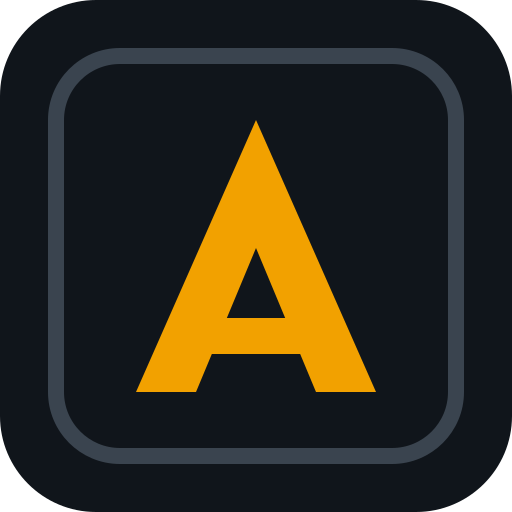

<p align="center">
  
</p>

<p align="center">
  
</p>

<p align="center">
  <b>The operating system for Philippine heavy-equipment rental MSMEs.</b>
  <br><br>
  Scan handwritten field logs, quote against live diesel in under a minute,
  <br>
  and flag weather risk on site.
</p>

<br>

<p align="center">
  
</p>

<h3 align="center">Tech stack</h3>

<h6 align="center">FRONTEND</h6>

<p align="center">
  
  
  
</p>

<h6 align="center">BACKEND</h6>

<p align="center">
  
  
</p>

<h6 align="center">DATA &amp; AI</h6>

<p align="center">
  
  
  
  
</p>

<h6 align="center">SERVICES</h6>

<p align="center">
  
  
</p>

<h6 align="center">HOSTING</h6>

<p align="center">
  
  
</p>

<br>

<p align="center">
  <sub>API and jobs run on <b>Azure Container Apps</b> &nbsp;·&nbsp; web served from <b>Cloudflare Workers</b> at arkilaunch.app</sub>
</p>

<br>

<p align="center">
  <a href="docs/index.md"><b>Docs</b></a>
  &nbsp;&nbsp;·&nbsp;&nbsp;
  <a href="docs/runbook-local-dev.md"><b>Local dev</b></a>
  &nbsp;&nbsp;·&nbsp;&nbsp;
  <a href="docs/pitch-arkilaunch.md"><b>Demo</b></a>
</p>

<p align="center">
  
</p>

<br>

## What it does

- Scans handwritten Equipment Daily Time Reports (EDTRs) with OCR and reconciles two independent logs before any deposit is deducted (PRD-F3).
- Generates diesel-indexed rental quotes in under a minute (PRD-F1).
- Manages a multi-tenant fleet with maintenance timers, weather-aware liability logging, and OCR-assisted KYC (PRD-F4, F5, F6).
- Takes bookings and payments through an authenticated customer portal (PRD-F2, F8).

## Quick start

```bash
cp .env.example .env   # Supabase pooler URLs + RS256 keypair; see comments in the file
pnpm install
pnpm db:migrate && pnpm db:seed
pnpm build && pnpm test
```

Full setup is in [docs/runbook-local-dev.md](docs/runbook-local-dev.md). Read [docs/index.md](docs/index.md) first: it is the doc manifest and lists which specs are Locked.

## Status

Backends for all eight features (F1..F8) are built and tested. The pilot is not yet deployed, and OCR has not yet been validated on real handwriting. [docs/index.md](docs/index.md) §4 is the authoritative Health Check.

## License

All rights reserved pending resolution of capstone IP ownership (CLR E10). See [LICENSE](LICENSE).
